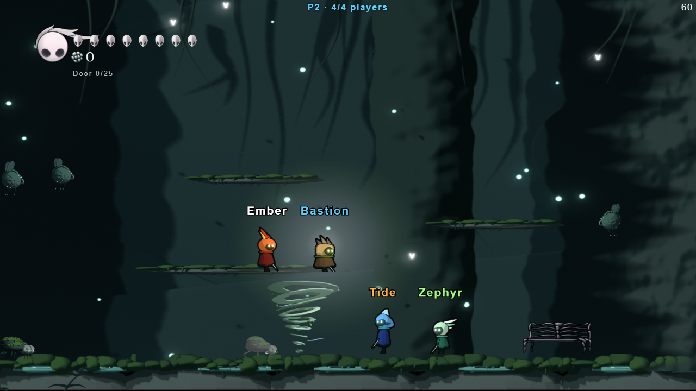

# WCL Knights

A 2D action platformer for the browser with **LAN co-op for up to 4 players**. Pick one of five
knights - four of them elemental heroes with their own stats and skill - fight through two areas
and two bosses together, revive each other, and compare scores at the end.

Built with vanilla JavaScript and HTML5 Canvas, with a small Node.js server for multiplayer.
Based on [hollow-knight-js](https://github.com/TinTinWinata/hollow-knight-js) by TinTin Winata,
a fan-made Hollow Knight tribute.



## ✨ Features

- **Solo or Play with Friends**: play alone offline, or co-op over your local network with up to
  4 players (lobby, ready-up, join mid-game, rejoin after a refresh, host migration if the host leaves)
- **Five heroes**: the Knight plus four elemental heroes with different body types, stats and skills
- **Two areas, two bosses**: the first area and the False Knight, then the Sunken Grove and the Grove Warden
- **Co-op that scales**: wider camera, tougher and more numerous enemies, boss health per player count
- **Revive and party wipe**: downed players wait for a teammate instead of respawning
- **Elemental combos**: fire, water, earth and wind skills combine when they touch
- **Bench shop**: spend coins on hearts, damage, reach, attack speed and skill charge
- **Scoreboard**: kills, boss damage, deaths, revives and a title for each player
- **Player names**, **boss health bars**, **controller support** and **fullscreen**

## 🦸 Heroes

| Hero | Element | Hearts | Plays like | Skill |
|------|---------|--------|------------|-------|
| **Knight** | - | 5 | Balanced all-rounder | **Soul Blast** - a piercing blast of soul |
| **Ember** | Fire | 4 | Fast, quick attacks, short reach | **Fireball** - a fast fireball that hits hard |
| **Bastion** | Earth | 8 | Slow, heavy tank | **Rock Spikes** - spikes burst from the ground in front |
| **Tide** | Water | 5 | Support, long reach | **Healing Wave** - heals you and nearby allies, splashes enemies |
| **Zephyr** | Wind | 3 | Fastest, high jumps, short dash cooldown | **Tornado** - a drifting tornado that keeps hitting |

Hero art is made in Blender (`tools/blender/wcl_art.blend`; brief in `docs/hero-art-brief.md`).

## 🚀 Getting Started

### Prerequisites
- A modern web browser (Chrome, Firefox, Edge)
- [Node.js](https://nodejs.org/) 18 or newer

### Installation

1. **Clone the repository**
   ```bash
   git clone https://github.com/gs4lthung/hollow-knight-js.git
   cd hollow-knight-js
   ```

2. **Install and start the LAN server**
   ```bash
   npm install
   npm start
   ```
   The server prints two kinds of link: `http://localhost:3000/game.html` for this computer, and `http://<your-ip>:3000/game.html` for friends on the same network.

3. **Play together (LAN co-op, up to 4 players)**
   - Everyone opens the link, picks a character and presses **Play with Friends** (**Solo** plays offline).
   - In the lobby everyone presses **Ready**; the host (first to join) presses **Start** and you all begin
     together. The lobby shows the link friends should open. Friends who join later drop straight in.
   - Type a name on the start screen; it shows above your knight, in the lobby and on the scoreboard.
   - Refreshed or dropped out? Rejoin within a minute to get your slot, colour and score back.
   - The host runs the enemies; keep the host's game tab in front.
   - Downed teammates can be revived: stand next to them and hold **E** for 2 seconds. If everyone is
     down, the party respawns (and the boss recovers). A scoreboard with kills, boss damage, deaths,
     revives and a title for each player shows before the credits.
   - On Windows, allow Node.js through the firewall (private networks) the first time a friend connects.
   - Opened without the server (any other static file server), the game runs in single-player mode.

### Hosting on IIS

IIS can run the game server for you (it starts and restarts `node server.js` itself), so friends
open `http://<pc-name-or-ip>/game.html` on port 80 instead of `:3000`. One-time setup, as an administrator:

1. **Windows features** (*Turn Windows features on or off* → Internet Information Services →
   World Wide Web Services → Application Development Features): tick **WebSocket Protocol**.
2. **Install [HttpPlatformHandler](https://www.iis.net/downloads/microsoft/httpplatformhandler)**
   (Microsoft's IIS module that runs Node behind IIS).
3. **Write the config** in the project folder: `npm install`, then `npm run iis-config`
   (`npm run iis-config -- 8080` if the site uses another port; add a public address as a second
   argument, e.g. `npm run iis-config -- 443 https://game.example.com`, to show that link in the lobby).
4. **Create the site** in IIS Manager: Sites → *Add Website*, physical path = the project folder,
   binding = port 80 (or your port). Give **IIS_IUSRS** read access to the folder and modify access to
   its `logs` folder (server output lands in `logs/node_*.log`).
5. Close any `npm start` window (it would be a separate game on `:3000`), open `http://localhost/game.html`, and let friends in
   through the Windows firewall on the site's port.

Players who open the game by the PC's address see that same address as the invite link in the lobby.


## 🎯 How to Play

### Controls
- **Left / Right Arrow**: Move
- **Z / Up Arrow**: Jump
- **X**: Attack with nail
- **S**: Dash
- **A**: Hero skill (charged by hitting enemies)
- **Space / E**: Interact (boss door, rest at bench); hold next to a downed teammate to revive
- **Escape**: Pause game
- **F**: Toggle fullscreen
- **Enter**: Start game

**Controller** (Xbox / PlayStation layout): stick or D-pad move, **A** jump, **X** attack,
**B** dash, **Y** skill, **LB/RB** interact (hold to revive), **Start** pause.
On the start screen the D-pad picks a knight and **A** starts; in the lobby **A** toggles Ready
and **Start** lets the host begin.

### Sunken Grove (Area 2)
Defeating the False Knight opens the way to the **Sunken Grove**, a flooded mossy cavern with
its own bench, new enemies and a second boss:
- **Mossling**: wanders, then charges at a knight who comes close.
- **Spore Drifter**: hovers out of reach and puffs spores (hit a spore to pop it).
- **Grove Warden**: walks in and slashes, leaps at far knights, and summons thorns under
  everyone (a glowing mark warns where they'll burst). Break its armor to stun it, then
  strike. Defeating it ends the run with the scoreboard.

The Grove's gate needs its own kills (shown as "Door" on the HUD). Its art lives in
`assets/game/area2/` (see `docs/area2-art-brief.md`); a piece that's missing falls back to a
teal-tinted stand-in from the first area, so new art can be dropped in without code changes.

### Bench Shop
Press **E** at the bench to rest (full hearts) and open the shop. Every kill by anyone on the
team gives each player a coin; spend them on upgrades: **Mask Shard** (+1 heart),
**Sharpened Nail** (+1 damage), **Soul Catcher** (skill charges faster), **Quick Slash**
(faster attacks), **Long Nail** (more reach). The HUD shows your coins and the kills the team
still needs to open the boss door. Alone the game pauses while you shop; with friends it
keeps going, but you can't be hurt at the bench.

### Elemental Combos
When two elements' skills touch, they combine:
- **Fire + Wind = Fire Tornado**: the tornado ignites, hits harder and faster, lasts longer
- **Fire + Water = Steam Burst**: an explosion around the water wave
- **Earth + Wind = Sandstorm**: the tornado grows and hits harder

### Gameplay Tips
- Kill enemies to open the boss door - the HUD shows how many kills the team still needs
- Rest at the bench to refill your hearts and spend coins
- Dash through attacks; use platforms to get above charging enemies
- In co-op, mix elements - skills that touch combine into combos
- Stay near teammates so you can revive each other

## 🏗️ Project Structure

```
hollow-knight-js/
├── server.js              # Serves the game and relays co-op messages (WebSocket at /ws)
├── game.html              # The game
├── index.html             # Landing page
├── assets/game/
│   ├── heroes/            # Sprites for the five heroes
│   ├── area2/             # Sunken Grove level, enemies and Grove Warden
│   └── ...                # First-area sprites, audio, UI
├── js/game/
│   ├── game.js            # Game loop, stages, co-op state, scoreboard
│   ├── heroes.js          # Hero stats and skills
│   ├── lobby.js           # Co-op lobby
│   ├── shop.js            # Bench shop
│   ├── gamepad.js         # Controller input
│   ├── model/             # Player, enemies, bosses, skills, level objects
│   ├── facade/            # Networking, audio, camera, asset loading
│   └── parent/            # Base classes
├── docs/                  # Art briefs and screenshot
└── tools/                 # Blender art project and IIS config script
```

## 🛠️ How Co-op Works

- The first player to join is the **host**: their game runs the enemies and bosses and sends
  snapshots to everyone 30 times a second. Each player sends their own knight's position and attacks.
- Hits by other players are sent to the host, which applies them, so everyone sees the same fight.
- If the host leaves, the next player takes over the enemies where they were.

## 📄 License

Fan-made and non-commercial, inspired by Hollow Knight by Team Cherry; the first area's art and
audio come from the original project. For educational purposes.

## 🙏 Acknowledgments

- **TinTin Winata**: original [hollow-knight-js](https://github.com/TinTinWinata/hollow-knight-js)
  (Web Design NAR 23-1)
- **Team Cherry**: creators of Hollow Knight
- **Christopher Larkin**: composer of the original soundtrack
